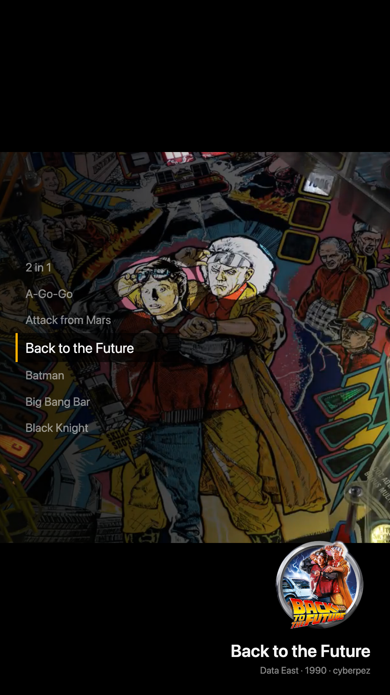

# Template

A small starting point for a VPinFE 3.0 theme.  It draws a list of tables on the left, the selected table's name, wheel and details on the right, and the table's playfield art behind both.  Everything else is VPinFE's own.

On a tall cabinet screen the list sits at the bottom.

The art behind the page is the table's video or image, whichever Playfield Media Priority in VPinFE's settings asks for.

## Install

Open Themes in the Console, find Template, and press Install.  Then press Make Active and restart VPinFE.  It needs VPinFE 3.0 or later.

## Settings

These are on the Themes page in the Console, under Template's settings.

| Setting | What it does |
| --- | --- |
| Rows | How many tables the list shows at once, from 3 to 13 in steps of 2.  7 by default. |
| Show Details | Shows the manufacturer, year and authors under the table's name.  On by default. |

## Make your own

Copy this folder and rename it `theme-<yourname>`.  Change the name, version, author and description in `manifest.json`, replace `preview.png` with a picture of your theme, and edit `index_playfield.html`, `style.css` and `theme.js`.  The theme reference is [docs/theme.md](https://github.com/vpinfe/vpinfe/blob/master/docs/theme.md) in VPinFE.
