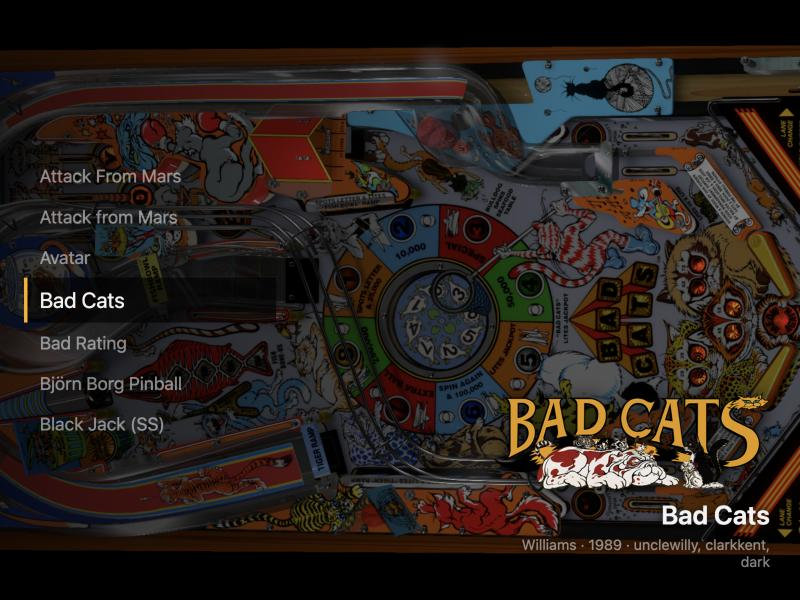

# Template

A small starting point for a VPinFE 3.0 theme. It draws a list of tables on the left, the
selected table's name, wheel and details on the right, and the table's playfield art behind
both. Everything else is core's.



Requires VPinFE 3.0 or later (`min_vpinfe` in `manifest.json`).

## Make your own

1. Copy this folder and rename it `theme-<yourname>`.
2. Change `name`, `version`, `author` and `description` in `manifest.json`, and replace
   `preview.png` with a screenshot of your theme.
3. Edit `index_playfield.html`, `style.css` and `theme.js`.

The theme reference is [docs/theme.md](https://github.com/vpinfe/vpinfe/blob/master/docs/theme.md)
in VPinFE.

## What is here

```
manifest.json         name, version, author, min_vpinfe and the windows the theme draws
options.json          the options a person can change, with their defaults
index_playfield.html  the playfield page
style.css             the look
theme.js              the behavior
locales/en.json       the theme's own words; add <language>.json to translate them
preview.png           shown in the theme list
```

## The two JSON files

JSON cannot carry comments, so what each field does is here.

`manifest.json`

| Field | What it does |
| --- | --- |
| `name`, `version`, `author`, `description` | Shown in the theme list. `version` is the theme's own release number |
| `preview_image` | The screenshot shown in the theme list |
| `type` | `both` adapts to a desktop screen or a cabinet; `desktop` and `cab` are the other two |
| `min_vpinfe` | The oldest VPinFE that can run the theme. `3.0` is what gets the core parts below |
| `windows` | The pages the theme draws. Template draws `playfield` only, so core's backglass and score view pages are used |
| `change_log` | A string, shown as "What's new" to someone installing the theme or updating it |

`options.json` declares what a person can change under the theme's settings. Each entry has
a `key`, a `name` and `description` the person reads, a `type` and a `default`. A `number`
also takes `min`, `max` and `step`. The types are `text`, `textarea`, `number`, `boolean`,
`select` and `json`. The theme reads the value from `vpin.themeConfig` under
the entry's `key`. Template declares two:

| Key | Type | What it does |
| --- | --- | --- |
| `rows` | number | How many tables the list shows at once |
| `showDetails` | boolean | Shows the manufacturer, year and authors under the name |

Every field of each type is in the theme reference, under Configuration Schema.

## The four parts of theme.js

`theme.js` has four parts, in this order, each commented:

1. **Options** - read what `options.json` declared.
2. **The list** - draw the rows around the selection.
3. **The selection** - draw the selected table.
4. **Messages** - hand every message to core, then redraw when the selection moves or the
   list changes.

A step slides the rows and a page jump cuts. That is the only motion the theme decides.

## Translating

A word a person reads goes through `vpin.t(key, english)`, and the theme's own words live in
`locales/`. Template has one, the label on the list, in `locales/en.json`:

```json
{ "tables": "Tables" }
```

`vpin.t("theme.tables", "Tables")` reads it. To translate Template, add a `locales/de.json`
beside it with the same keys. A language or a key the theme does not have falls back to
`en.json`, then to the English written in the call. Core's own words, such as
`frontend.theme.no_tables_found`, are translated by core and cannot be changed from here.

## What core does, so this theme does not

| Core handles | The theme's part |
| --- | --- |
| Keys, buttons and the remote: stepping, paging, the menu and the collection picker | Launch on `select` |
| Moving the selection and wrapping around the list | Draw the rows (`activeList().indexAfter`) |
| Choosing the table's media and its fallbacks | Mark an element with `data-vpin-media` |
| Audio for the selected table | Nothing |
| Preloading the neighbors | Nothing |
| Turning the page and the art for a sideways cabinet screen | Put `vpinfe-upright` on the outermost element |
| The loading indicator while a table starts | Restyle `.vpinfe-launch-spinner` |
| Attract mode | Nothing |
| The backglass and score view pages | Nothing: Template ships none, so core's are used |

## Opt-outs

Template uses none of these. A theme that draws one of these things itself turns core's off
in a `config.json` next to `manifest.json`, and says why in its own README.

| Core's part | Key in `config.json` | Default for a 3.0 theme |
| --- | --- | --- |
| Moving and paging the selection | `navigation.enabled` | on |
| Audio | `audio.enabled` | on |
| Turning the page and the art | `layout.enabled` | on |
| Preloading the neighbors | `preload.enabled` | on |
| The loading indicator | `launch_indicator.enabled` | on |
| Attract mode | `attract.enabled` | on |
| Dimming windows while a table launches | `launch_dim.enabled` | on |
| Media in an element marked `data-vpin-media` | `media_window.enabled` | on |
| The waiting-for-tables notice | `waiting.enabled` | on |
| The hold ring | `hold_ring.enabled` | on |

For example, a theme with its own launch screen:

```json
{ "launch_indicator": { "enabled": false } }
```

`vpin.enabled("core_launch_indicator")` tells the theme at run time whether core's is on.
A backglass or score view page is an opt-out by shipping one: add `index_backglass.html` or
`index_scoreview.html` and list the window in `manifest.json`.
